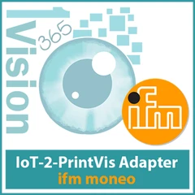

# 1Vision IoT-2-PrintVis Adapter - ifm moneo

{ .app-icon }

<!-- agent:begin overview -->
The ifm moneo adapter connects ifm moneo devices to PrintVis. It translates the messages of ifm moneo into signals that the [IoT-2-PrintVis Connector](../iot2printvis-connector/index.md) understands, such as counter values and their timestamps.

| | |
|---|---|
| **Publisher** | 1Vision365 |
| **Latest version** | 28.5.285.0 |
| **Minimum Business Central version** | 28.0 |
| **Requires** | PrintVis 28.0 or later, [1Vision IoT Link](../iot-link/index.md) 28.2.0.0 or later, [1Vision IoT-2-PrintVis Connector](../iot2printvis-connector/index.md) 28.2.0.0 or later, 1Vision Core Library 28.2.0.0 or later |
<!-- agent:end overview -->

## Where to start

1. [Install the app](installation.md)
2. [Configure it](configuration.md)
3. [Learn what it can do](features.md)
