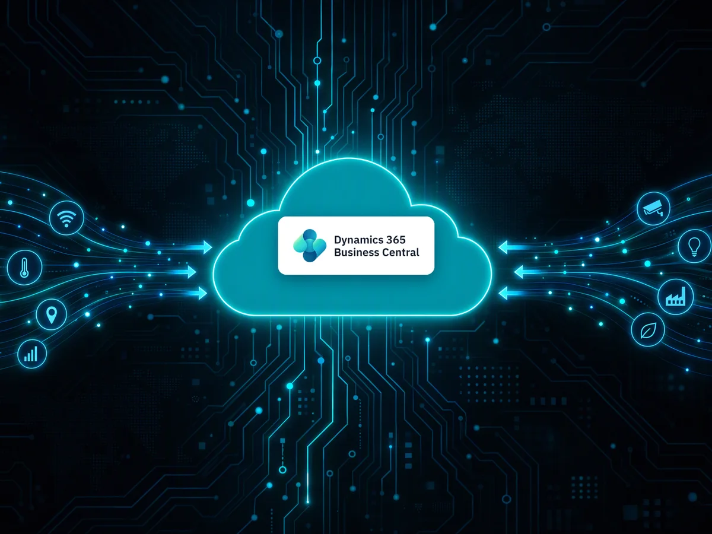
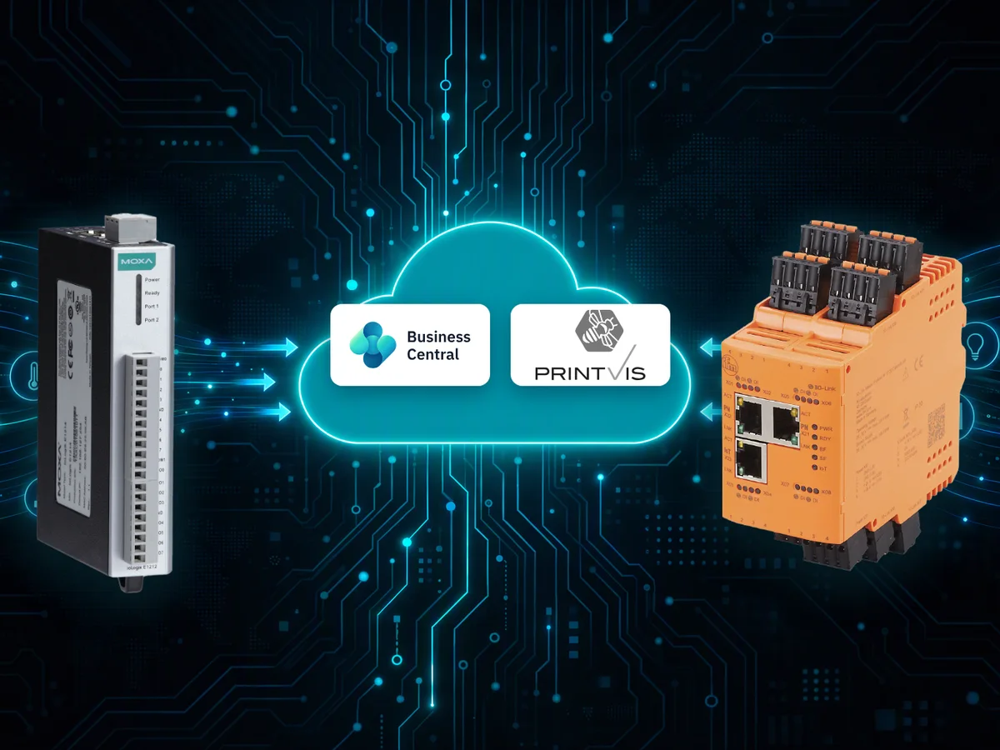
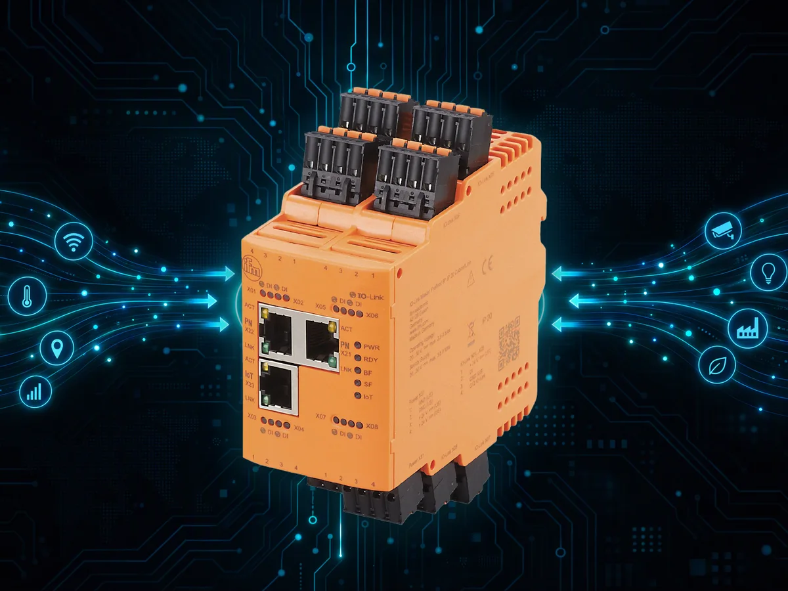
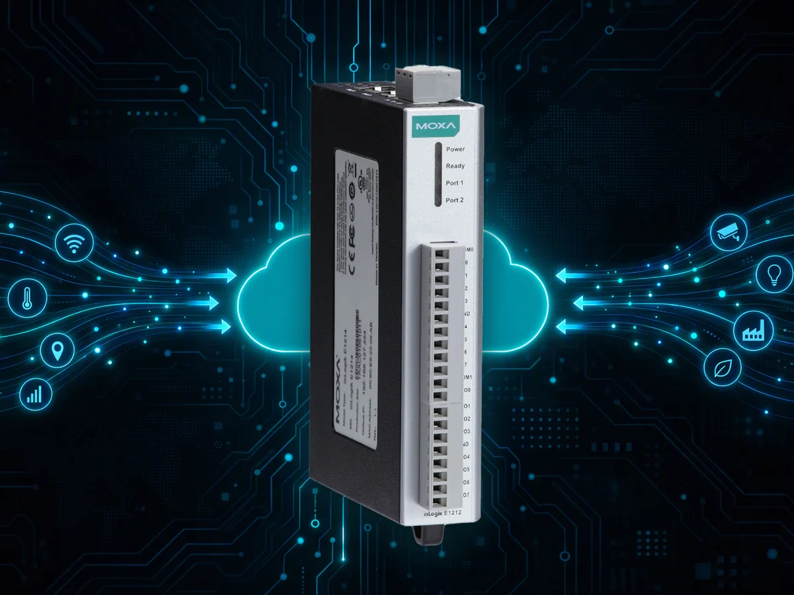

Documentation

# 1Vision365 app documentation

Help and guides for the 1Vision365 apps for Microsoft Dynamics 365 Business Central.

## Apps

<a class="app-card" href="apps/iot-link/">

<strong>1Vision IoT Link</strong>
The generic IoT solution: receive IoT messages through Azure and process them in Business Central.
Open the docs →

</a>
<a class="app-card" href="apps/iot2printvis-connector/">

<strong>1Vision IoT-2-PrintVis Connector</strong>
Counters, speed and idle time from your machines on the PrintVis electronic job ticket.
Open the docs →

</a>
<a class="app-card" href="apps/iot2printvis-adapter-ifm-moneo/">

<strong>1Vision IoT-2-PrintVis Adapter - ifm moneo</strong>
Connect ifm moneo devices to PrintVis.
Open the docs →

</a>
<a class="app-card" href="apps/iot2printvis-adapter-moxa/">

<strong>1Vision IoT-2-PrintVis Adapter - Moxa</strong>
Connect Moxa devices to PrintVis.
Open the docs →

</a>

## Need help?

See [Support](support.md) or the [Privacy policy](privacy.md).
